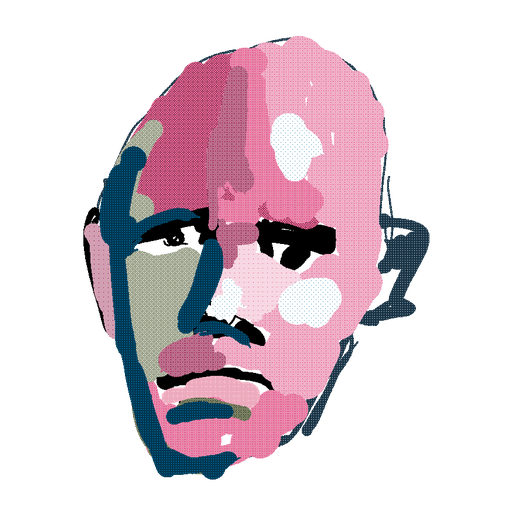
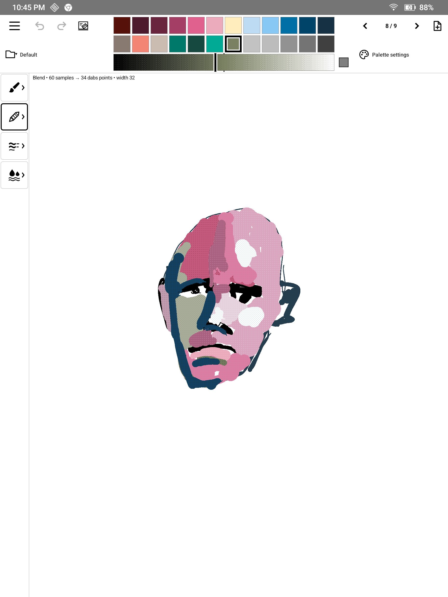

# SadPaint

A painting app for **color E Ink tablets**, built for the BOOX Note Air 6C.
Opaque paint, palettes, dithered shades, smudge and watercolor, with the
BOOX fast pen preview so strokes keep up with the stylus.



## Which tablets?

SadPaint uses the **BOOX (Onyx) pen SDK** for its live ink, so it needs a
BOOX tablet with a stylus. It is developed on the **Note Air 6C**; other color
BOOX models (Tab Ultra C, Note Air 3 C/4 C, Go Color 7, Palma C, etc.) should work
but are untested. On non‑BOOX tablets (Kobo, PocketBook, Bigme, reMarkable…)
the painting screen won't get pen input. Reports welcome in Issues.

## Install (sideload)

1. On the tablet, open this page in the browser and download
   **`SadPaint-<version>.apk`** from the
   [latest release](../../releases/latest).
2. Tap the downloaded file (or open it from the **Storage** / file manager app).
3. If Android blocks it, allow **Install unknown apps** for the browser or file
   manager you used. On BOOX: *Settings → Apps → App Management*, or the
   prompt that appears. Then tap **Install**.
4. Open **SadPaint** from the app library.

From a computer instead, with USB debugging on
(*Settings → About → tap Build number*, then *Developer options → USB debugging*):

```sh
adb install -r SadPaint-0.9.0.apk
```

**BOOX tips:** in the app's E Ink settings (long-press the icon → *Optimize*),
a faster refresh mode helps. Use **Refresh screen** in the brush menu to clear
ghosting.

Updates install over the old version and keep your paintings, as long as both
APKs come from this repo's releases.

## Build from source

Needs JDK 17/21 and Android SDK platform 34 (`ANDROID_HOME` set).

```sh
./gradlew :app:assembleDebug
adb install -r app/build/outputs/apk/debug/app-debug.apk
```

## License

[MIT](LICENSE).

The painting app itself is described under [Painting app](#painting-app-09).
Everything below is the original development log.

---

## Development notes: pen feasibility test

Small Android APK implementing the first experiment in
[the spec](boox_note_air6c_paint_app_spec.md): test BOOX raw pen input,
pressure, and live opaque color on the actual panel.

### Build and install

Requires JDK 17 or 21 and Android SDK platform 34. Set `ANDROID_HOME` to your
SDK directory (or use `sdk.dir` in `local.properties`).

```sh
./gradlew :app:assembleDebug :app:testDebugUnitTest :app:lintDebug
adb install -r app/build/outputs/apk/debug/app-debug.apk
adb shell am start -n dev.tilesmile.pentest/dev.tilesmile.MainActivity
```

On the development machine:

```sh
JAVA_HOME=/usr/lib/jvm/java-21-openjdk-amd64 \
ANDROID_HOME=/home/teddy/Android/Sdk \
./gradlew :app:assembleDebug :app:testDebugUnitTest :app:lintDebug
```

### Five-minute physical pen test

Use the stylus in the white canvas; tap a swatch to switch ink immediately.
Finger painting is disabled. The selected swatch has a check mark and thick
border. The palette offers pale blue `#C7D8E8`, light blue `#9CBBD6`, the original
blue `#6F9EC5`, deep blue `#315F88`, blue-gray `#566B78`, and black `#000000`.
Each swatch selects the opaque finished ink. Once the visibility survey has
confirmed the original blue is visible, the app opens in native mode A and
automatically uses that known-good blue preview for all five finished blue
shades, with black preview for black. Saved favorites override these defaults
unless marked invisible. No manual matching survey is required. Before that
confirmation, the app retains its earlier live-bitmap default.
Existing strokes keep their colors when you select another shade.

| Mode | Input | During pen-down | After pen-up |
| --- | --- | --- | --- |
| A: Native color | BOOX raw callbacks | SDK fountain pen, chosen preview RGB | Opaque finished ink |
| B: Live bitmap | BOOX raw callbacks | Custom RGB brush, dirty surface updates | Same image |
| C: Black preview | BOOX raw callbacks | SDK black fountain pen | Opaque selected color |
| Android control | Android stylus MotionEvents | Custom RGB brush | Same image |

1. Before visibility calibration, the app opens in **B** with **Fast ink** enabled and **Live stats** off.
   Draw fast circles and vary pressure. Confirm the status says
   **BOOX raw callbacks received**, with increasing callback count and changing
   pressure. `SDK created=true` alone is not proof of working raw input.
2. Check whether ink is blue **while moving**. Toggle **Fast ink** off and on to
   compare the old and new bitmap schedules. Leave Live stats off for this
   comparison. Mode A remains a speed comparison, but its native preview is
   known to display some pale blues as white and blue-gray as black.
3. Repeat in **B**, **C**, and **Android control**. In B, the status must say
   **Native preview OFF**, including after lifting and starting another stroke.
   B is an experiment: firmware
   may hold normal screen updates while raw capture is active, even with native
   rendering disabled. Record whether color appears before or only after lift.
4. Draw neighboring strokes with each blue shade, including some overlaps.
   Compare their color while drawing, after lifting, and after **Clean refresh**.
   Paint over the same blue area ten times. The
   backing pixels must stay the same blue. Inspect the settled physical color.
5. Disable **Live stats** and compare speed again: UI refreshes can perturb
   E Ink drawing. Switch apps and return; verify the raw pen still works.

The rate is received samples per second over the current/last stroke, not panel
refresh rate or end-to-end pen latency. Measure physical latency with a camera
or compare by feel. A screenshot cannot show an E Ink waveform or reliably
capture the native overlay. Native preview width/shape may differ from the
custom pressure curve after pen-up.

### Scope and implementation

- One screen-sized backing image, pressure mapped to 1.5–32 physical pixels,
  gamma 1.4. No zoom, layers, persistence, or palette editor yet.
- Hard round interpolated stamps replace pixels with fully opaque ARGB.
  No antialiasing or alpha accumulation. The six JVM tests cover overlap,
  replacement, sparse-sample interpolation, pressure, clipping, and dirty bounds.
- Surface buffer updates use dirty rectangles; the platform may expand them.
  This requests local application redraws, not a guarantee of a particular
  physical E Ink refresh rectangle or waveform.
- Raw preview modes defer backing-image presentation until pen-up. With Fast
  ink enabled, bitmap mode waits for surface buffers on a worker thread,
  then copies the freshest available samples before submitting the frame.
  It reserves a 128-pixel margin around dirty content to include nearby samples
  arriving during the buffer wait. Changes outside that clip remain dirty for
  the next frame. No predicted ink is drawn and no input samples are dropped.
  Fast ink off restores the original 16 ms batch delay on the main thread.
  Live stats default to off; when enabled they update at most 4 times a second.
  SDK 1.5.4.4 enables its native renderer whenever `setRawDrawingEnabled(true)`
  is called; B disables rendering **after** that call. B keeps raw input running
  across pen lifts. Version 0.2 applied those settings in the wrong order, so
  its live-bitmap result was confounded by an active native preview.
- Losing focus or pausing closes raw drawing; returning reopens it. SDK failures
  are visible and logged. Android control is an explicit selection, never a
  silent substitute for a working BOOX path.
- Drawings survive surface resize in memory (cropped at the new edges), but
  are lost when the app process ends. **Clear** erases this test canvas.

### Painting app (0.9)

The launcher now opens the painting screen. It is laid out like the Manta app:
the palette along the top bar and an icon rail on the left (Brush, Undo, Redo,
Palettes, More). Test screens are under the **More** (settings) icon.

- **Palette** along the top bar: 1–4 rows of 12 spots (set per palette), in a
  fixed-height bar so switching palettes never resizes the canvas. Tap a color
  to paint with it, long-press to edit it (hue, saturation, and brightness
  sliders or hex, preview override). Tapping an empty spot or the **palette
  icon** to the right opens the palette popup; arranging happens only there.
  Tap the palette name at the top left to switch saved palettes.
- **Shade bar** under the palette, as wide as its grid and as tall as one
  palette row (rows and bar share the fixed top bar, so the canvas never
  resizes): one continuous gradient of the selected color, black (left)
  through the pure color (middle, marked by ticks) to white (right), 64 levels
  each way, drawn in the real 1 px 8×8 Bayer dither with black/white. A smooth
  solid blend was tried on the panel (2026-10-19) and looked worse. Tap or drag
  along it; the ink changes on lift. Strokes lay down the pattern itself,
  aligned to canvas pixels so overlaps join seamlessly (`Shade`,
  `OpaqueRaster.pattern`); watercolor glazes with it too. Each color
  remembers its own shade (prefs `shade64-RRGGBB`), in every palette; a color
  never shaded starts pure. The fast
  preview gray follows the shade's overall lightness.
- **Saved palettes** (prefs `palettes-v1`): named, e.g. "Zorn". On first run
  the old palette became "Default". Edits made on the paint screen are saved
  to the active palette's saved copy too. Format: `rows=3|RRGGBB:auto,-,...`
  (`-` = empty spot; the rows prefix is omitted for the default 2).
- **Palette popup:** the calibration picks grid on top, as on the Picks
  screen. Browns share the tans' column. Below it, the palette's spots with
  one **selected spot** (framed; it starts at the first empty spot). Tap an
  empty spot to select it; tap a color to delete it (its spot becomes the
  selected one). Tap a pick to put it in the
  selected spot (replacing what is there; a pick already in the palette moves
  there), and the selection steps to the next spot. Picks already in the
  palette are framed in the grid. You can also drag a pick onto any spot, or
  drag a palette color to any spot (it swaps with what is there), so rows can
  be organized with gaps. **Rows
  − / +** (1–4; you can't drop a row that still has colors). Palette line:
  name (tap to rename), **Save**, **Save as new**, **Open** (saved list with
  Delete, plus "New empty"), **Use** (save, make it the painting palette,
  close). **Done** asks before dropping unsaved changes. The palette being
  painted with can't be deleted. Reordering and deleting picks stays on
  More → Picks.
- **Brush settings:** tap the Brush icon (chevron) for width − / +, the live
  preview mode (fast or true color), **Fast preview: gray for every color**
  (default on: every color previews as the visible gray of its lightness,
  ignoring per-color overrides) or per-color, and Refresh screen.
- **Gray preview test** (More → Gray preview test): the firmware draws light
  gray requests much darker than asked (white's F8F8F8 looked mid gray). For
  each of 16 gray requests (000000…FEFEFE) you draw a stroke and tap the
  finished gray it looked like while moving, or Invisible. Answers go in prefs
  `preview-gray-v1` and the gray preview then picks the request whose *live*
  look is closest in lightness. Unmeasured grays count at face value.
  **Result (2026-09-25, NoteAir6C):** 000000→00, 202020→1A, 404040→33,
  606060→4D, 808080→66, A0A0A0→80, C0C0C0→99, and every request from
  D0D0D0 to FEFEFE looked B3. The live gray can't get lighter than about B3,
  so all pale colors preview at that same light-mid gray. The light color
  round (16 bright hues such as FFFF00, 00FFFF, FF00FF, FFFF40) found none
  lighter either: all B3 or darker. **White paint** (L > 99) therefore
  previews as pure FFFFFF. Confirmed on the panel (2026-09-25): the live
  white stroke covers dark ink while drawing.
- **Brush** is BOOX's fountain ("ink") pen: light pressure makes hairlines,
  heavy pressure goes up to the selected width (− / + , 2–240 px).
- **Preview ↔ final match.** While the pen is down, the firmware draws its
  native fountain preview. On pen-up the same samples go through the SDK's
  fountain engine (`NeoFountainPenWrapper.computeStrokePoints`, the path
  BOOX's demo uses to redraw strokes). It returns a width for each point,
  and the app rasterizes those as opaque, unantialiased round-capped segments.
  The finished stroke should therefore have the preview's shape. Only the color
  is exact after lift. Untested on the panel so far.
- **Preview color** defaults to the visible gray (0.7.1 survey) closest in
  lightness to the paint, so a pale pink previews light gray. The native
  preview's hues are unreliable; its grays are predictable. Override it per
  color in the editor.
- Undo/redo (per stroke, including Clear), clean refresh, and the canvas is
  saved to app storage as PNG on pause.
- The status line shows, per stroke: raw samples, the SDK list size, shaped
  point count, and **tilt X/Y ranges**. Everything is also logged as `paint stroke`.

Not yet: zoom/pan, pressure-curve tuning (the firmware preview uses raw
pressure, so a custom curve would break the match), PNG export.

### Which preview requests are visible? (0.7)

Open **Preview visibility test**. It presents one RGB request at a time, starting
with black as a control. Draw with the physical pen and judge whether any ink
appears **while the pen is moving**, ignoring the finished stroke after lift.
Tap the large **VISIBLE** or **INVISIBLE** button; the answer is saved and the
next untested request opens automatically. Previous and Skip allow revisiting
or deferring a sample. Progress persists across app restarts.

The buttons enable after a completed positive-pressure raw pen stroke. The
answers live in `preview-visibility-v1` private preferences, with per-request
timestamps and firmware fingerprints. Invisible means invisible on the white
canvas, including white ink. Counts describe requests, not distinct preview
colors; multiple visible requests may look identical.

An automatic native-only probe used BOOX's documented `startStroke`,
`addStrokePoint`, and `finishStroke` commands. Black, original blue, and pale blue
all produced blank screenshot readbacks while the application bitmap stayed
white. Start calls returned zero width. This is inconclusive: it does not prove
that the commands rendered physical ink or that screenshots include the native
layer. No visibility results were inferred or recorded from this probe.

```sh
adb shell am instrument -w -e nativeProbe true dev.tilesmile.pentest.test/dev.tilesmile.PerfInstrumentation
adb shell am instrument -w -e visibility true dev.tilesmile.pentest.test/dev.tilesmile.PerfInstrumentation
```

The visibility UI check uses isolated, deleted test preferences for simulated
answers; it verifies the physical-stroke gate, save-and-advance flow, and that
real observations are unchanged. The native probe replaces temporary drawings.
Stroke command reference: [BOOX Scribble API](https://github.com/onyx-intl/OnyxAndroidDemo/blob/master/doc/Scribble-API.md).
Its historical monochrome-only statement is not used to infer this tablet's
actual preview palette.

### Match a fast preview to a finished color (0.6)

Tap **Match preview colors**. The **Finished color** selector at the top chooses
what strokes become after pen-up. The colored **preview swatches** change only
the RGB requested from BOOX's fast native fountain brush while the pen is down.
For example, a yellow preview request can settle into pale blue after lifting.
The firmware may display a preview request differently from its RGB swatch.

Choose one finished blue, tap a preview swatch, and draw as many strokes as you
like. Tap other preview swatches to compare them against that same finished
blue. Changing preview swatches preserves existing strokes and the finished
color. Nothing advances automatically. Preview swatches appear together in a
nine-column grid, with requests marked invisible in the visibility survey
hidden. All six finished colors remain available, including pale/light blue.
**Clear + refresh** resets the drawing when wanted. Choosing a
different finished color starts a fresh canvas.

**Save favorite** remembers the selected preview RGB for this finished color,
and stays on the current choice. Returning to that finished color restores its
favorite. Favorites also apply to native previews on the main drawing screen.
The automatic defaults use the original blue for this prototype's blue shades
and black for black. This is an approximate preview, not a measured nearest-color
mapping for arbitrary RGB colors. These are user preferences, not
color measurements. Old survey records are retained in their original private
preferences; the comparison screen replaces that survey UI.

The first six preview choices are the original inks, followed by saturated
colors, grayscale, a blue sweep, and the remaining coarse RGB-cube points.
These are candidate requests, not a measured list of supported panel colors.

```sh
adb shell input keyevent KEYCODE_WAKEUP
adb shell am instrument -w -e preview true dev.tilesmile.pentest.test/dev.tilesmile.PerfInstrumentation
```

This software check tries all 63 preview requests with one fixed finished ink,
verifies final bitmap pixels, preserved strokes, target changes, native mode,
selection stability, unchanged favorites, and pause/resume. It replaces the
comparison canvas with synthetic strokes, then restores the selected colors.
It cannot determine physical preview appearance; use the real pen for that.

### SDK references

Uses `onyxsdk-pen:1.5.4.4`, matching the current
[official BOOX pen sample](https://github.com/onyx-intl/OnyxAndroidDemo/blob/master/app/OnyxPenDemo/build.gradle).
Initialization follows the
[official Application](https://github.com/onyx-intl/OnyxAndroidDemo/blob/master/app/OnyxPenDemo/src/main/java/com/onyx/android/eink/pen/demo/DemoApplication.java)
and [TouchHelper example](https://github.com/onyx-intl/OnyxAndroidDemo/blob/master/app/OnyxPenDemo/src/main/java/com/onyx/android/eink/pen/demo/scribble/ui/ScribbleTouchHelperDemoActivity.java).
The firmware API compatibility bridge is scoped to vendor namespaces and the
vendor's `View` refresh methods. No root,
firmware patch, or device security-setting changes are used.

The SDK's three unused legacy dependencies (permission helper, MMKV, Hugo
annotations) are excluded because their old versions are unavailable from
Maven Central. Other dependencies resolve from Central, Google, and BOOX HTTPS.

[SurfaceHolder's dirty-region contract](https://developer.android.com/reference/android/view/SurfaceHolder#lockCanvas(android.graphics.Rect))
requires drawing the whole returned clip, which this renderer does.

### Diagnostics

```sh
adb logcat -s TileSmile:I AndroidRuntime:E
adb shell dumpsys package dev.tilesmile.pentest
```

`TileSmile` logs SDK creation, pressure maximum, callback counts per stroke,
stroke duration, mode, and failures. Raw samples must come from a real pen to
claim hardware feasibility; synthetic Android events only test software paths.

### Performance replay

The separate test APK runs six alternating old/new bitmap replays, compares
every final bitmap pixel with a reference raster, and checks fast jumps,
color changes, pause/resume, and raw-input/native-render state. It replaces
the current test canvas. It bypasses EMR input and does not measure the panel.

```sh
./gradlew :app:assembleDebug :app:assembleDebugAndroidTest
adb install -r app/build/outputs/apk/debug/app-debug.apk
adb install -r app/build/outputs/apk/androidTest/debug/app-debug-androidTest.apk
adb shell input keyevent KEYCODE_WAKEUP
adb shell am instrument -w dev.tilesmile.pentest.test/dev.tilesmile.PerfInstrumentation
adb logcat -d -s TileSmile:I AndroidRuntime:E
```

`perf` logs separate brush, bitmap copy, buffer wait, draw, and post costs.
`newestP50Ms`/`newestP95Ms` measure the age of the newest received sample when
the frame is submitted, not when it appears on E Ink. Frames whose reserved
clip does not cover all current damage are excluded from that freshness
statistic; their remaining damage is rendered subsequently. `submitP50Ms`
tracks the oldest pending change, so it measures a different property.
